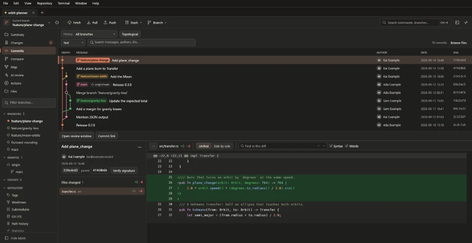
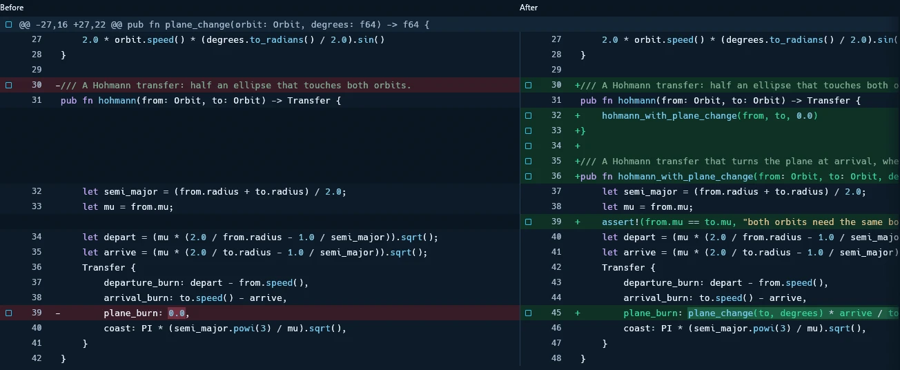
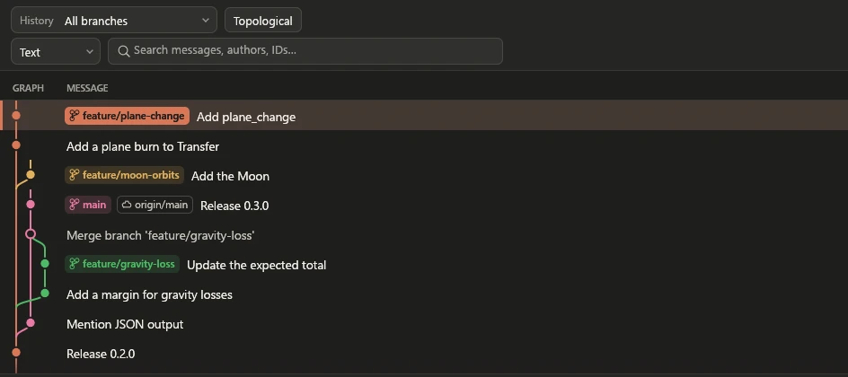
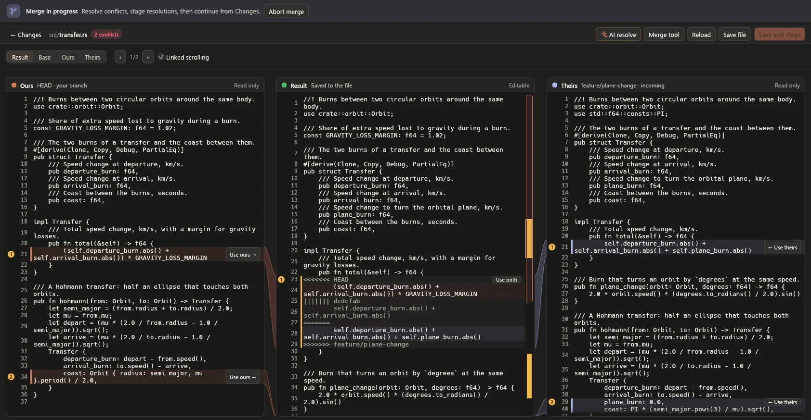
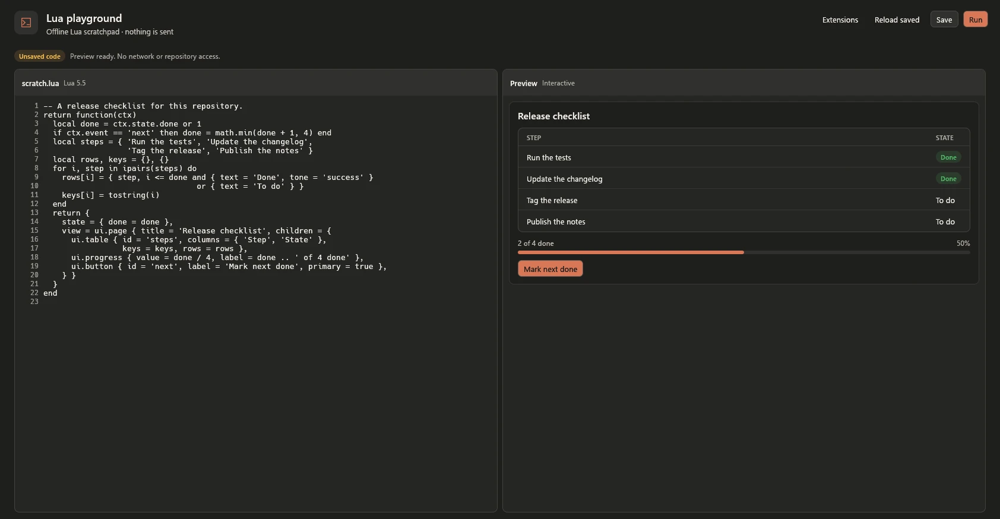

<p align="center">
  
</p>

<h1 align="center">Rocket</h1>

<p align="center">
  <strong>A native Windows Git client built in Rust.</strong><br>
  An open-source alternative to Fork and GitKraken: review changes, manage branches and
  work with remotes in one desktop app.
</p>

<p align="center">
  <a href="#features">Features</a> ·
  <a href="#extensions">Extensions</a> ·
  <a href="#comparison">Comparison</a> ·
  <a href="docs/wiki/Home.md">Wiki / start here</a> ·
  <a href="#build-and-run">Build and run</a> ·
  <a href="#getting-started">Getting started</a> ·
  <a href="crates/rocket-ui/src/guide.md">User guide</a> ·
  <a href="CLI.md">CLI</a> ·
  <a href="CHANGELOG.md">Changelog</a>
</p>

<p align="center">
  <picture>
    <source media="(prefers-color-scheme: light)" srcset="docs/media/theme-clay-light.webp">
    
  </picture>
</p>

## What is Rocket?

Rocket is an open-source alternative to Fork and GitKraken Desktop for Windows. It
brings everyday Git work and advanced history tools into a native desktop workspace.
Open several repositories in tabs, inspect changes, prepare commits, manage branches
and resolve conflicts without leaving the app, and add your own features with
[extensions](#extensions). The [comparison](#comparison) shows how they differ.

The desktop UI and standalone CLI share the same Rust backend and use Git's own
repository formats and operations. New bundled builds include **Git for Windows
2.56.0.windows.4**: Automatic prefers that copy, while explicit installed/custom
choices remain available. HTTPS and SSH use your configured credential helpers
and SSH setup. Rocket itself does not require a .NET runtime.

Current development version: **0.92.0**. See the [changelog](CHANGELOG.md) for
release history and the [user guide](crates/rocket-ui/src/guide.md) for individual
workflows.

Rocket checks public [GitHub Releases](https://github.com/JasXTD/Rocket/releases)
once when it launches. **Help → Check for Updates** checks on demand. Updates are
downloaded and installed only when you choose; packaged installations retain
their previous version for recovery. See [App updates](docs/wiki/App-updates.md).

**New to Rocket?** Follow the [first-commit walkthrough](docs/wiki/Getting-started.md)
or use the [wiki](docs/wiki/Home.md) to find instructions for a specific task.
Inside the app, **Help → Setup Guide** walks you through a first local commit, and
**Help → Guide** (`F1`) explains the current workflow.

The Windows ZIP includes bundled Git and the required native runtimes. Extract
the complete archive and open `rocket.exe` normally; no installer or administrator
access is needed. The Lua worker keeps its isolated execution and links its
runtime into the worker executable.

## Features

### Changes and code review

<p align="center">
  <picture>
    <source media="(prefers-color-scheme: light)" srcset="docs/media/split-light.webp">
    
  </picture>
</p>

- Stage or unstage whole files, including dragging selections between the Staged
  and Unstaged groups. Select individual hunks or lines for supported text changes.
- Read unified or side-by-side diffs with syntax highlighting, word highlights, search
  and an overview strip for long files. Compare images with overlays, a swipe view and
  pixel differences.
- Compare branches, commits, the staging area or tracked working-tree contents.
  Open commit details, file history and blame in independent review windows.
- Save several external editor, diff and merge tool profiles. External merge
  results are reviewed before they are imported into working files.
- Customize keyboard shortcuts and mouse gestures in **Preferences → Shortcuts**, with
  two bindings per command, duplicate checks, reset options and a search by keys.

### History and branch workflows

<p align="center">
  <picture>
    <source media="(prefers-color-scheme: light)" srcset="docs/media/history-light.webp">
    
  </picture>
</p>

- See how a repository fits together in the native
  [Repository map](docs/wiki/Repository-map.md): Cargo packages and the folder tree,
  branches and merges, and who works where, with a details card and Mermaid export.
  Local, cancellable reads have explicit limits.

- Browse the commit graph across branches, search beyond the currently loaded
  commits, follow file renames and browse the repository tree at a chosen commit.
- Find code: commits that add, remove or edit text (`git log -S`, or `-G` for a
  regular expression, optionally under one path), and **Search in files** at the
  checkout or any commit (`git grep`), grouped by file and opening each match at its
  line. Both stream on workers with match, line and time limits and stop at once.
- Create, switch, rename and clean up branches; merge or rebase with a preview.
  Rebase can preserve merge structure, subject to its documented mode limits.
- Plan interactive rebases with reorder, reword, edit, squash, fixup and drop,
  including explicit stops and commands.
- Amend commits, cherry-pick a series or revert selected commits. Supported
  operations offer conflict prediction and Continue, Skip or Abort recovery.

### Remotes and collaboration

- See every SSH key in **Preferences → SSH keys**: keys found in your SSH folder and keys
  Rocket made. Copy a public key, unlock a key in ssh-agent, or make one repository use
  only one key after a review. Existing keys and SSH config stay in place.
  **Direct key** mode works without ssh-agent, with opt-in Windows-encrypted
  passphrase storage, a Forget action and strict server host-key verification.
- Clone over HTTPS, SSH or from a local repository, with progress and cancellation.
  Add, edit, rename or remove remotes from the desktop.
- Fetch remote changes and choose fast-forward only, merge or rebase when pulling.
  Background fetch is optional and does not merge into your working branch.
- Review normal pushes and force-with-lease pushes. Publish several branches
  atomically when the server supports all-or-nothing updates.
- Inspect, publish and safely delete remote tags; review remote branch deletion
  and pruning of obsolete tracking references.

### Conflicts, saved work and recovery

<p align="center">
  <picture>
    <source media="(prefers-color-scheme: light)" srcset="docs/media/conflict-light.webp">
    
  </picture>
</p>

- Resolve supported text conflicts in a three-column editor with linked scrolling
  and conflict navigation. Binary and delete/modify conflicts use whole versions.
- Get an AI proposal for a conflict from Claude Code, Codex or a connected MCP agent.
  Review the explanation and proposed result before applying it to the editor draft. Each
  applied conflict keeps its own Undo, and saving and staging retain recovery backups and
  external-change checks.
- Save and inspect stashes, apply or drop them, and apply selected files, hunks or
  lines from supported saved text changes.
- Discard or restore supported files and selected changes with recovery copies
  and checks for edits made outside Rocket.
- Undo the latest ordinary commit made in the current Rocket session with a reviewed
  **Edit → Undo Last Commit**. Files and staging stay, and a recovery reference keeps the
  commit. See [recovery](docs/wiki/Recovery-and-troubleshooting.md#undo-the-last-local-commit)
  for its limits.
- Inspect reflogs, find lost commits and recover them onto new branches. Use
  manual or automated bisect to locate a change that introduced a problem.
- Import and export patches and commit series, with recovery for interrupted
  or conflicting applications.

### AI assistance

AI tools are optional and run only when you ask. They use Claude Code or Codex on your
computer, under that program's own account; Rocket stores no AI API key. Repository
content you send can leave your computer, so each tool shows or explains it first.

- **AI drafts** write a commit message from staged changes, once you turn them on in
  **Preferences → Commit messages**. Nothing is committed for you.
- **AI review** sends a previewed branch diff for review. It changes no files.
- **AI resolve** proposes a resolution for a conflicted file, from either program or a
  connected MCP agent. You review the proposal and apply it to the editor draft yourself.

### Extensions

Add your own features to Rocket with extensions: sandboxed Lua packages with their own
native panels, forms and tables, plus commands in the palette, the Repository menu and
right-click menus.

<p align="center">
  <picture>
    <source media="(prefers-color-scheme: light)" srcset="docs/media/lua-light.webp">
    
  </picture>
</p>

- Install a package from a file after a review of its code and permissions. An extension
  can't run Git or shell commands, read your files or see your tokens.
- Write your own with the [extension API](INTEGRATIONS.md), an offline Lua code and preview
  playground and developer tools that validate Lua. Optional read-only repository context
  supports dashboards.
- Jira and PlayGround ship with Rocket and start off. Jira Cloud support includes search,
  issue edits and transitions, with classic or scoped API tokens, protected credentials and
  reviewed remote writes.
- Named connections keep accounts and saved drafts separate, and an invalid package doesn't
  block healthy extensions.

See the [extensions guide](docs/wiki/Integrations.md).

### Repository management

- Organize saved repositories into folders and nested workspaces in the **Repository
  manager**, with independent tabs, commit drafts and view preferences. Use **Scan
  folder** to discover repositories and worktrees together, review duplicates and
  save selected shortcuts without opening every repository.
  See the [repository manager guide](docs/wiki/Repository-manager.md).
- See every saved repository's branch, uncommitted changes and commits to push or
  pull without opening it, filter to the ones that **Need attention**, and update a
  folder or workspace with **Fetch all** and **Pull all**. Pull all only fast-forwards
  a clean branch; anything else is skipped and listed, and neither asks for a password.
- **Explore** other people's repositories without leaving Rocket (File → Explore
  Repositories, Ctrl+Shift+E): search GitHub, or paste any repository address, then
  **Preview** one read-only in a tab where Commits, Files, Map and Statistics work at once.
  Older file versions download only when a view needs them, nothing from the repository
  runs, and a preview stops at 1 GB unless you continue without a limit. **Keep** turns it
  into a normal clone in a folder you choose; **Discard** deletes it. Preview and
  Keep always limit object enumeration to 100,000 missing objects and 32 MiB of
  output, even without the disk limit; use **Clone** for larger graphs.
- Manage linked worktrees, local tags, submodules and nested submodules, including
  reviewed submodule add, move, remove, sync and update operations.
- Inspect Git LFS files and objects, manage tracking rules and locks, and review
  fetch, checkout and local storage cleanup operations.
- Edit ignore rules, choose templates and configure repository-local identity
  and signing. Inspect commit and tag signatures.

### Accounts and everyday tools

- Connect GitHub, GitHub Enterprise Server, GitLab, Bitbucket Cloud, Bitbucket Server/Data Center,
  Azure DevOps Services, Azure DevOps Server or Gitea through provider-specific hosting adapters.
  Azure DevOps Server uses an HTTPS collection, server-issued PAT and explicit
  API version for PRs, project work items and reviewed PR creation. See
  [Server setup and limits](HOSTING.md#azure-devops-server-unreleased).
- Browse pull requests and supported issue/work-item lists, prepare reviewed
  PR/MR creation, and inspect PR details, available checks and reviews. The current
  development build adds protected review drafts and restart recovery, GitHub
  discussion replies/resolution and multiline reviews, plus provider-supported
  reviews and merges, with [scope and verification limits](HOSTING.md).
- See CI results where you already look: a mark beside each pushed commit and
  branch for GitHub, GitHub Enterprise Server, GitLab, Gitea, Bitbucket Cloud and
  Azure DevOps, the checks behind it, and a reviewed **Re-run failed jobs** on
  GitHub, GitLab and Gitea. **Actions** in the sidebar lists the repository's runs
  with each run's jobs, and says how to connect when no account reads them. Token
  permissions are in [CI status](HOSTING.md#ci-status-on-commits-and-branches-unreleased).
- Manage Windows OpenSSH keys and repository-specific profiles for multiple
  accounts while preserving your existing keys and main SSH configuration.
- Use the integrated terminal (Windows PowerShell, Git Bash, Command Prompt, PowerShell 7 or your own shell), command palette, configurable shortcuts,
  scoped custom commands, activity history and diagnostic viewer. **Help → Crash
  Reports** reviews local crash metadata and exports JSON without automatic uploads.
- Choose a theme: Clay, the default, in Claude Code's colours (following Windows or kept
  dark or light), Ocean (Rocket's original navy), Dark, Light, System, or Custom with your
  own accent colour and a picture behind the window.
- Set up Rocket in **Preferences → General**: a source code folder for new clones, tags in
  fetch, spaces in branch names, submodule updates on checkout, Push after commit, diff font
  and marks, and compact branch labels.
- See who commits, when and which files change most on the **Statistics** page.
- Measure local refresh, history and diff-read times with **View → Repository
  Benchmark**, including cancellation and a summary that omits repository content.

Hosting accounts are separate from Git transport credentials. Connecting an API
account does not automatically change a remote URL or your Git/SSH login.
Provider capabilities and live-test coverage differ; see [Hosting](HOSTING.md).

## Comparison

Rocket covers many of the everyday Git workflows found in Fork and GitKraken
Desktop. Lazygit provides a terminal interface for those workflows. The table
compares selected features, with different interfaces and scopes called out.

Checked **2026-10-27** against Rocket **0.87.1** and the other projects' official
documentation. The Extensions row was checked on **2026-10-31** against Rocket
**0.87.3**. This is a documentation comparison, not a performance benchmark or a
claim of equal maturity. Features and licensing can change.

| Area | Rocket | [Fork](https://git-fork.com/) | [GitKraken Desktop](https://gitkraken.com/git-client) | [Lazygit](https://github.com/jesseduffield/lazygit) |
| --- | --- | --- | --- | --- |
| Interface | Native Rust desktop | Desktop GUI | Desktop GUI and integrated terminal | Terminal UI (TUI) |
| Platforms | Windows x64 validated | Windows, macOS | Windows, macOS, Linux | Windows, macOS, Linux and others |
| Stage files, hunks and lines | Supported text changes | Supported | [Supported](https://help.gitkraken.com/gitkraken-desktop/staging/) | Supported |
| Interactive rebase | Reorder, reword, edit, squash, fixup, drop | Visual interactive rebase | [Visual interactive rebase](https://help.gitkraken.com/gitkraken-desktop/interactive-rebase/) | Interactive rebase and individual history-editing actions |
| Resolve conflicts | Three-column editor; backups and external-edit checks | Built-in resolver and external tools | Visual merge tool; [plan-dependent capabilities](https://gitkraken.com/pricing) | [Hunk resolution and external editing](https://github.com/jesseduffield/lazygit/blob/master/docs/keybindings/Keybindings_en.md) |
| Linked worktrees | Create, open, inspect and manage | [Worktree creation and navigation](https://git-fork.com/releasenoteswin) | [Worktree support](https://help.gitkraken.com/gitkraken-desktop/worktrees/) | Create and switch worktrees |
| Organize repositories | Saved folders, nested workspaces and tabs | Repository manager and [nested workspaces](https://git-fork.com/releasenoteswin) | [Local and shared cloud workspaces](https://help.gitkraken.com/gitkraken-desktop/workspaces/) | [Recent-repository switcher](https://github.com/jesseduffield/lazygit/blob/master/docs/keybindings/Keybindings_en.md) |
| Hosting and pull requests | GitHub reviews; additional adapters with [verification limits](HOSTING.md) | [Provider integrations, PR creation and filtered lists](https://git-fork.com/releasenoteswin) | [Hosting and issue-tracker integrations](https://help.gitkraken.com/gitkraken-desktop/integrations/); plan dependent | [Open PRs in a browser](https://github.com/jesseduffield/lazygit/blob/master/docs/keybindings/Keybindings_en.md); custom commands |
| Commands and automation | Scoped commands, tool profiles, JSON CLI and local UI MCP | [Contextual custom commands and external tools](https://git-fork.com/releasenoteswin) | [Companion CLI and MCP](https://help.gitkraken.com/cli/cli-home/); scope differs from desktop controls | [Configurable commands and keybindings](https://github.com/jesseduffield/lazygit/blob/master/docs/Custom_Command_Keybindings.md) |
| Extensions | Add your own features with sandboxed Lua packages: native panels, commands and reviewed permissions | [Custom commands](https://git-fork.com/releasenotes); no extension API found in its documentation | [Browser extension](https://help.gitkraken.com/browser-extension/browser-extension-home/) and [agent status plugins](https://help.gitkraken.com/gitkraken-desktop/agents/); no third-party extension API found in its documentation | [Custom commands](https://github.com/jesseduffield/lazygit/blob/master/docs/Custom_Command_Keybindings.md); no plugin API found in its documentation |
| Licensing | [MIT](LICENSE-MIT) or [Apache-2.0](LICENSE-APACHE) | Commercial license; free evaluation | [Free Community and paid plans](https://gitkraken.com/pricing); private remotes require a paid plan | MIT; free and open source |

Rocket remains in development. Its Windows workflows have focused test coverage;
live acceptance for GitHub Enterprise Server, GitLab, Bitbucket, Azure DevOps and Gitea remains unverified.
The [current limits](#current-limits) and [wiki](docs/wiki/Home.md) explain the
supported cases. A shared feature name does not imply identical behavior or
recovery guarantees across these applications.

## Requirements

| Component | When it is needed |
| --- | --- |
| Windows x64 | Current validated desktop platform; testing has focused on Windows 10. |
| Git runtime | Included in new bundled builds. Source-only builds need installed Git 2.46+ on PATH or a configured executable. |
| Rust MSVC toolchain and Microsoft C++ build tools | Required to build Rocket from source. |
| Windows PowerShell | The integrated terminal's default shell. Git Bash comes with the bundled Git. |
| Git Credential Manager | Included in new bundled builds; required for the supported browser sign-in flows. |
| Windows OpenSSH | Used by Rocket's SSH key/profile manager. SSH remotes need a working SSH configuration. |
| Git LFS 3.8.1+ | Included in new bundled builds; required only for Git LFS operations. |
| Claude Code or Codex | Optional. Used by AI drafts, AI review and AI resolve. |

Windows HTTP(S) Git operations additionally require Git for Windows
**2.56.0.windows.4 or newer**. Older or unrecognized Windows builds are restricted
to local/SSH transport; see [the runtime security policy](SECURITY.md#windows-git-http-runtime-gate-2026-10-29).

Node.js is used by some development and MCP test scripts. The desktop app, CLI
and Rust MCP server do not require Node.js to run. Rocket does not download or
update these tools automatically, or replace their system installations.

## Build and run

From the Rocket source directory, build the workspace and start the desktop app:

```powershell
.\tools\Build-Local.ps1
.\target\release\rocket.exe
```

Add `-Offline` if the locked dependencies are already cached, or `-Profile debug`
for a debug bundle. The build compiles the Lua worker first and embeds its SHA-256
in Rocket and MCP, then produces the desktop, CLI and helpers under `target/release/`.
Unsigned builds and releases are supported; no certificate is required. Plain
`cargo build` without this binding compiles but disables Lua execution.

When moving a build, keep its supporting files together:

| File or folder | Purpose |
| --- | --- |
| `rocket.exe` | Desktop application. |
| `rocket-cli.exe` | Standalone command-line interface. |
| `rocket-mcp.exe` | Optional localhost service for native UI automation. |
| `rocket-terminal-host.exe` | Starts the integrated terminal with command interruption support. |
| `rocket-rebase-editor.exe` | Applies Rocket's reviewed interactive-rebase plans. |
| `rocket-lua-host.exe` | Matching hash-verified worker, isolated by Windows for every Lua invocation. |
| `conpty/` | Bundled Microsoft terminal runtime and its license. |
| `git/` | Included Git for Windows runtime with Git Credential Manager and Git LFS, in new bundled builds. |

Copying only `rocket.exe` omits the included Git and the terminal, rebase and Lua helpers. The bundled native
runtime's origin and hashes are recorded in [ConPTY provenance](runtime/conpty/1.25.260930003/README.md).

### Linux (preview)

Rocket builds and opens on Linux under X11 or Wayland; this has been checked under WSL2
Ubuntu 26.04 with WSLg. Install Rust 1.95 or later, a C compiler and Git 2.46 or later
from your distribution, then:

```bash
cargo build --workspace --locked
./target/debug/rocket
```

Add `--features rocket-integrations/runtime` for the release feature set. Rocket uses the
first `git` on `PATH`; Linux has no bundled Git. Settings, logs and crash reports live in
`$XDG_STATE_HOME/rocket`, by default `~/.local/state/rocket`. As it refuses Run as
administrator on Windows, Rocket refuses to run as root, for example under `sudo`.

Some features use what the system provides, and nothing else is needed to build:

- the terminal runs your login shell, or bash, zsh or fish as `/etc/shells` lists them;
- SSH keys use OpenSSH from `/usr/bin` (Ubuntu's `openssh-client`) and the ssh-agent that
  `SSH_AUTH_SOCK` names;
- remembered tokens and passphrases need libsecret (`libsecret-1-0`) and an unlocked
  desktop keyring such as GNOME Keyring;
- spell checking needs a Hunspell dictionary, such as `hunspell-en-us`;
- dependency checks need OSV-Scanner 2.7.0 for Linux x64, chosen in Edit → Preferences →
  Security → Scanner & data;
- Git LFS features need Git LFS 3.8.1 or later beside Git. Ubuntu 26.04 ships 3.7.1, so
  install it from the Git LFS release.

See [Current limits](#current-limits) for what still needs Windows.

## Getting started

1. **Open, create or clone a repository.** Use Open for an existing Git checkout,
   New Repository for a project that is not yet under Git, or Clone for a remote.
   Clone requires a destination that does not already exist.
2. **Check your commit identity.** Repository Settings can set a local name/email
   override. Preferences also provides Git selection and global identity settings.
3. **Review changes.** Select a file in Changes to inspect its diff. Stage whole
   files or supported selections, then write a commit message. Staging and
   committing are local operations.
4. **Synchronize when ready.** Fetch to inspect remote updates, choose a pull
   strategy if needed, then review the branches and destination before pushing.
5. **Use recovery when an operation pauses.** Resolve conflicts in Changes and
   follow the operation's Continue, Skip or Abort review. Check the reported state
   after cancellation before trying again.

Press **Ctrl+K** for the command palette or **F1** for the built-in guide. The
[user guide](crates/rocket-ui/src/guide.md) covers the individual dialogs, keyboard
behavior and recovery limits in more detail.

## Command-line interface

`rocket-cli.exe` calls the same backend as the desktop and supports structured
JSON output. Repository commands can run without the desktop app. For example,
from the source directory after building:

```powershell
.\target\release\rocket-cli.exe --help
$repo = Read-Host 'Full path to an existing Git repository'
.\target\release\rocket-cli.exe --repo "$repo" status
.\target\release\rocket-cli.exe --repo "$repo" --json status
```

Use a real repository path when prompted. Preview-capable writes expose the
reviewed state before applying; JSON includes operation errors and recovery
information. Desktop and CLI writes share repository write coordination.
The CLI does not yet expose every desktop workflow; see the [CLI reference](CLI.md).

## Localhost MCP

The optional MCP service exposes the real desktop controls, state, progress,
screenshots and diagnostics over a local HTTP endpoint. This supports repeatable
native UI testing and compatible local automation clients.

Use **Edit → Preferences → MCP server** to configure the loopback port, access token and fixture
folder, and explicitly start or stop the service. Keep the token private and use
temporary repositories for write tests. Some actions are limited by the service's
test scope; it is not an unrestricted remote shell.

Connected agents can also read conflict snapshots you explicitly share from
**AI resolve** and submit proposals for review, without opening a test window.
These tools cannot apply, save, stage or commit the result.

See the [tools guide](tools/README.md#localhost-mcp) for the launcher, connection
checks and focused test runners. Live hosting tests require separate account
setup and authorization.

## Safety and recovery

- **Review and recheck:** supported write previews pin the selected commits,
  paths and settings. External changes can invalidate a review before execution.
- **Recovery data:** supported destructive file operations keep recovery copies;
  history-rewriting workflows retain original tips through recovery references.
- **Cancellation:** stopping an operation does not undo work already completed.
  Rocket refreshes or checks the result and reports uncertainty when necessary.
- **Secret protection:** local checks can block recognized credentials in commits
  and pushes. Pattern detection has limits and does not replace credential
  revocation or a repository security review.
- **Guard AI API keys:** a separate, default-on Security setting checks supported
  OpenAI, Anthropic, DeepSeek, GLM/Z.ai and other provider key formats locally.
  Both guards also check outgoing history; neither sends keys to a provider.
- **Diagnostics:** operation history and structured logs help trace failures and
  cancellation. Review any exported diagnostic information before sharing it.

Each operation has its own supported cases and recovery limits. See the
[security boundaries](SECURITY.md) and [user guide](crates/rocket-ui/src/guide.md).

## Project structure

| Component | Responsibility |
| --- | --- |
| `crates/rocket-ui` | Native Rust desktop UI built with egui/eframe. |
| `crates/rocket-git` | Git process execution, parsing, previews, write coordination and recovery; no third-party Rust dependencies. |
| `crates/rocket-integrations` | Extension packages, native panel descriptions and the Lua worker. Package discovery never runs code, and credentials stay in the host. |
| `crates/rocket-cli` | Command-line parsing and text/JSON output over the shared backend. |
| `crates/rocket-mcp` and `crates/rocket-mcp-control` | Local UI automation service and its control integration. |
| `crates/rocket-terminal` and `crates/rocket-spell` | Terminal support and commit-message spelling assistance. |
| `runtime/` | Reviewed native runtime files and provenance records. |
| `tools/` | Reusable development scripts, mockups and focused tests. |

Build output and generated test fixtures stay in ignored `target/` and `work/`
folders. Start validation with the checks for the feature being changed; the
[development tools guide](tools/README.md) describes their setup and scope.

## Current limits

- Windows is the validated platform. On Linux, everyday Git work runs with the system
  Git: opening, creating and cloning repositories, history, diffs, staging, committing,
  fetching, automatic refresh, worktrees, the conflict editor, whole-file replacements,
  ignore rules, patch files and submodules. The integrated terminal, SSH keys, remembered
  hosting tokens, MCP control, spell check, dependency checks, automatic bisect and LFS
  cache cleanup work too. Lua extensions and app updates still report that they need
  Windows. Steps that must never replace a file need a local filesystem such
  as ext4, XFS or Btrfs; NFS, some FUSE mounts and WSL's `/mnt` drives are refused. Automatic refresh uses at most half of `fs.inotify.max_user_watches` and is
  not told about changes made through a network share. LFS tracking-rule edits are
  unverified on Linux. The MCP terminal runners run on Linux with bash probes. Most other
  MCP acceptance runners still expect Windows program names and tools. macOS is unverified.
- Hosting adapters have different capabilities. Live acceptance for GitHub Enterprise Server, GitLab,
  Bitbucket, Azure DevOps and Gitea remains unverified; local fixtures do not prove
  a real organization's permissions, SSO or server policy. See [Hosting](HOSTING.md).
- Partial diff/stash actions support specific text and file cases. Unsupported
  filters, encodings, file types or patch formats may need a whole-file action or
  a Git workflow outside Rocket.
- Jira has been tested against mock services, not a live server. The AI conflict page has
  been tested with a stand-in program, not a real Claude Code or Codex reply.
- The CLI and localhost MCP expose subsets of the desktop workflows. Available
  commands and test scope are documented in their respective guides.

## Documentation

- [Beginner wiki](docs/wiki/Home.md) — first commit, everyday work, remotes and recovery.
- [User guide](crates/rocket-ui/src/guide.md) — desktop workflows and recovery.
- [CLI reference](CLI.md) — commands, JSON output and cancellation.
- [Hosting](HOSTING.md) — accounts, providers and verification limits.
- [Extensions](docs/wiki/Integrations.md) — install, enable and update extensions.
- [Extension API](INTEGRATIONS.md) — write your own extension package.
- [Security](SECURITY.md) — safeguards and known boundaries.
- [Dependencies](DEPENDENCIES.md) — dependency and runtime review records.
- [Development tools](tools/README.md) — focused tests and localhost MCP.
- [Changelog](CHANGELOG.md) — version history.

## License

Licensed under either [Apache-2.0](LICENSE-APACHE) or [MIT](LICENSE-MIT), at your
option. See [third-party notices](THIRD-PARTY-NOTICES.txt) for bundled components.
