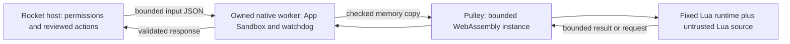

# macOS Lua: WebAssembly isolation and app integration

Status: isolated compatibility prototype passed on WSL and native Apple Silicon,
2026-11-09, following the [native App Sandbox probes](MacOS-lua-sandbox.md#measured-result).
The approved dependency/tool archives were hash-verified, source-reviewed, scanned
by the user with Malwarebytes and staged outside production builds. An approved
unwind-enabled standard-library rebuild fixed the initial callback-error failures.
Native containment/lifecycle/pressure qualification passed (evidence below).
The signed helper is now bound to Rocket.app; native integration passed on
2026-11-09 in [run 42517429117](https://github.com/JasXTD/Rocket/actions/runs/42517429117)
on `d94c0dcf557967f18d04d31d5a33d5963c7623a1`. Windows/Linux retain their native
sandboxes and root Cargo dependencies. Developer ID and bare-metal acceptance
remain separate from this development-runner result.

## Recommendation

Continue from the tested Lua prototype inside **Wasmtime 50.0.1 using its Pulley
interpreter**, toward a separate Mac worker with App Sandbox as an outer boundary.
The user approved app integration after the isolated qualification. This is not
a safety certification; the native VM and operating system remain trusted.

## App binding and build order

The helper workspace remains separate under `tools/prototypes/macos-lua-wasm`
to preserve the approved lock and keep Wasmtime out of Windows/Linux builds.
It now also supplies the Mac app helper; its compiler/probe executables are not
shipped. Build the same-source guest with the approved unwind-enabled toolchain,
then run `tools/macos/build-lua-helper.sh GUEST_WASM NEW_OUTPUT` on a native Mac
using that workspace's offline Cargo home and separate target directory.

Intel builds use the same fixed guest and Pulley isolation, compiled into a native
`x86_64` helper. The UI/MCP hosts must be built for that same architecture and bind
its final signed hash; packaging rejects an ARM helper in an Intel app and vice
versa. The manual workflow's `x64` choice prepares the native qualification run.
The recorded native results in this document are Apple Silicon results; Intel
containment, lifecycle and complete-package runtime acceptance are still pending.

The output is `RocketLua.app`, its final signed executable digest, and
`LUA-NOTICES` containing approved dependencies' license texts. Set
`ROCKET_MACOS_LUA_APP` to this app when running `tools/build-macos.sh`. The build
verifies its exact App Sandbox entitlement and hardened runtime, derives the
SHA-256 from signed bytes, then embeds it into UI/MCP hosts. Package it at
`Rocket.app/Contents/Helpers/RocketLua.app`. Finalizing the outer app must never
re-sign the bound helper. Developer ID signing must occur before host binding too.
Without this helper, ordinary Mac builds remain unbound and refuse execution.

The launcher copies only the three sealed helper files into a new private
per-run directory, checks the copied executable against the embedded hash,
verifies the app signature/resources using Security.framework, and starts it
with no environment, three I/O pipes and a separate parent lifeline. It never
executes the mutable installed pathname. The guard checks its own signature and
entitlements before reading input. Cancellation terminates/reaps the owned
process; normal cleanup removes only its fixed snapshot files. A parent crash
can leave inert snapshot files, never adopted by a later run.

This copy is protected against packages, guest code and other users, not an
arbitrary malicious native process already running as the same user. Such a
process can also replace an unsigned Rocket host. This is **not** Linux's sealed
memfd guarantee. The in-process watchdog's trust/suspension limits and sampled
192 MiB native threshold still apply; 128 MiB is the guest linear-memory limit.
No new dependency versions or system software are introduced by integration.

### Native app integration evidence

The Darwin/arm64 run passed nine worker/preflight test entries (including the
child-process fixture), two native-entry refusal checks and the production
playground consumer test. These cover a real signed worker, Unicode results,
sanitized script errors, instruction limits, pre-cancel, cancellation/reaping,
output limits, timeout, parent exit during startup, changed hashes/resources,
linked/writable-file refusal and normal snapshot removal. The native Lua entry
point still refuses Mac execution; only the bound Wasm helper is accepted.

All five application executables built with the final helper binding. Thirteen
bundle tests were discovered: twelve passed, and the test that explicitly refuses
native signing on other operating systems was skipped on Mac. Exact inventory,
helper entitlements/identity, system-only dynamic dependencies, code signatures,
host/hash matching and extracted ZIP verification passed. Both retained evidence
ZIPs matched GitHub's SHA-256; the guest digest also matched its build sidecar.
The earlier zero-import guest is unchanged:
`c99cfc35909a145fd978668b216cbfadf9ce4ad1a89721c7af88ca7aed6a0c9b`.

Signed helper SHA-256:
`30052b155857800f0ee8eb6f1ed46570f71e9776d03157d3bb13438fd571075d`.
The development ZIP was 103,270,986 bytes, SHA-256
`5d04568616ca303320c0d695db0305eb8ac3c29d243b3e3e6069c355fe410243`.
The ZIP was verified on the runner; only compact evidence was retained, not a
release download. No GitHub release was published and no interactive desktop
Lua UI or bare-metal session is claimed by these backend/package tests.

Windows preflight/UI-MCP compilation and WSL's real native Lua worker/consumer
tests passed. The final cumulative ledger is 69 rounded minutes, conservatively
**$4.278 of the $6 included-compute cap** (all jobs counted at the Mac rate).
This is a compute estimate, not an invoice; no billing settings were changed.

The objective is unchanged Lua scripts and Rocket's existing reviewed request/UI
protocol. A Lua/native-library fault should still be confined to WebAssembly
memory, without an API for accessing the native worker's container, credentials,
files, sockets or processes. The native VM and its embedding remain trusted code.
A defect there could expose the weaker outer sandbox; WebAssembly does not make
those residual risks disappear.

| Candidate | Finding | Decision for the first prototype |
| --- | --- | --- |
| App Sandbox alone | Native testing found persistent container access and no established 128 MiB native cap. | Insufficient by itself; retain as an additional boundary. |
| Wasmi 2.0.0 | Its versioned feature table lists exception handling as planned. Rocket's current Lua WASI build uses it for error unwinding. | Do not assume compatibility or remove error recovery to make it fit. |
| Wasmtime 50.0.1 / Pulley | The versioned documentation describes interpreter parity with Cranelift, including the required Wasm features. Exceptions require Wasmtime's `gc` build feature. | Preferred compatibility experiment; prove the exact configuration and resource bounds. |
| Native-code Wasmtime execution | Another possible route, but generated executable memory adds Mac signing/entitlement considerations. | Defer while the interpreter route is assessed. |

Sources: [Wasmi 2.0.0 feature table](https://github.com/wasmi-labs/wasmi/blob/v2.0.0/README.md),
[Wasmtime 50.0.1 Pulley design](https://github.com/bytecodealliance/wasmtime/blob/v50.0.1/docs/examples-pulley.md),
[versioned exception configuration](https://github.com/bytecodealliance/wasmtime/blob/v50.0.1/crates/wasmtime/src/config.rs).
These establish source-level feasibility, not tested Rocket compatibility.

## Trust and data flow

This is the intended production flow, not a qualified sandbox. The prototype
implements the fixed guest/VM boundary only. All HTTP/Git actions and
credential use stay in the existing host-side authorization flow. The guest only
returns data. Never pass native pointers, file descriptors, repository handles,
environment contents, tokens or an unrestricted host-call interface to it.

Ship one trusted guest, built from Rocket's reviewed Lua/runtime sources. Extension
authors provide Lua source, not Wasm/Pulley modules. Prefer embedding the compiled
guest bytes in the helper so their identity follows the helper's code signature;
otherwise verify a bound digest over the exact bytes subsequently loaded, with no
path re-open race. Keep runtime version, target, feature settings and guest digest
bound together, and reject mismatches before processing script input.

Pulley supports precompilation during the build. That could remove the compiler
from the shipped worker and avoid native JIT execution. However, Wasmtime's
precompiled format is trusted executable input, not a validated interchange
format. Never deserialize an extension-supplied or unverified cache file. The
minimum runtime feature set and absence of JIT entitlements still need native
proof. [Wasmtime precompilation and safety requirements](https://docs.wasmtime.dev/examples-pre-compiling-wasm.html).

## Compatibility work before implementation

Rocket currently pins `mlua 0.12.2`, `mlua-sys 0.13.0` and `lua-src 551.1.0`
(Lua 5.5.1). Local source inspection found that `lua-src`'s WASI path emits standard
Wasm exceptions and links `setjmp`; the `mlua` README documents Emscripten support,
which does not prove the proposed WASI target works. WASI SDK's own documentation
describes its setjmp/longjmp support as evolving. Check real Lua `pcall`, `xpcall`,
syntax errors, nested callbacks, allocator failure, finalizers and Rust/Lua unwind
boundaries before accepting the toolchain.
[WASI SDK 34 error-unwinding implementation](https://github.com/WebAssembly/wasi-sdk/blob/wasi-sdk-34/SetjmpLongjmp.md).

The reusable code is `crates/rocket-integrations/src/runtime.rs`: it accepts and
returns JSON and already exposes declarative UI/request functions. It currently
depends on the crate's request model, while the crate itself depends on
`rocket-git`. A small shared runtime/protocol layer should separate those pieces
from catalog/storage/native launch code; do not copy the SDK or compile the whole
Git backend into the guest. Keep existing host validation authoritative. Extract
only after compatibility is proved, with existing tests protecting Windows/Linux.

The current native `host.rs` calls `enter_isolation` before reading stdin. Do not
make that entry point succeed on Mac as a shortcut. The proposed Mac launcher and
guest need their own verified path; refusal remains the default during experiments.

Inspect the guest's actual imports and exports. Target zero ambient capabilities:
no filesystem, socket, process, environment or clock imports. If compiler/runtime
support requires a small shim, enumerate it explicitly and prove its bounded
in-memory behavior. Do not silently link a general WASI implementation or inherit
stdio, directories or environment. Unexpected imports are a build/test failure,
not a reason to grant more host access. The exact minimal import set is unknown
until the first real build.

## Resource and lifecycle contract

These are acceptance criteria for the prototype, not current guarantees:

- One fresh native worker and fresh guest store/instance per invocation; destroy
  them after one response. Do not expose or reuse persistent app-container state.
- Exactly one non-shared 32-bit linear memory, capped at 128 MiB in both the guest
  module and the runtime limiter. Reject shared memory, threads, extra memories,
  dynamic modules and unused proposals. Cap table entries and instance counts too.
- Account separately for the Wasm execution stack, exception/GC storage, host JSON
  buffers and VM bookkeeping. A linear-memory cap is **not** a 128 MiB process RSS
  cap. The exception implementation's additional allocations are an explicit test
  gate; do not disable needed exception support to hide that accounting problem.
- Preserve the current 8 MiB input, 1 MiB output and 4 KiB diagnostic limits.
  Check pointer/length arithmetic, bounds and allocation limits before copying;
  cap parsing depth and aggregate response size. Never trust a guest response to
  authorize a host action. Do not log script payloads or credentials.
- Fuel limits plus the existing five-second wall deadline. Test loops inside Lua
  library code and repeated error handling as well as ordinary Lua loops. Keep a
  host-side termination path independent of guest cooperation; Stop must wait for
  actual exit and reject late/stale results.
- Verify host and supervisor crash/exit handling, early cancellation, startup
  races, inherited handles and absence of surviving children. App Sandbox and an
  interpreter alone do not solve process lifecycle ownership.

Wasmtime's [resource-limiter contract](https://github.com/bytecodealliance/wasmtime/blob/v50.0.1/crates/wasmtime/src/runtime/limits.rs)
explicitly excludes some native/store allocations and does not apply its normal
growth callback to shared memory. This is why resource totals and shared-memory
rejection must be independent checks rather than a single memory-size setting.

## Supply-chain research and approval boundary

Read-only metadata checks on 2026-11-09 confirmed the official crates.io records
for `wasmtime 50.0.1` and `pulley-interpreter 50.0.1` point to Bytecode Alliance's
repository. Both were published 2026-10-29, were not yanked, and declare Rust 1.97
(the project uses 1.99.1). OSV's version queries returned no listed advisories for
these two exact versions or the Wasmi comparator. **This is not a full dependency
audit or evidence that the packages contain no exploitable defect.**

The [50.0.1 release notes](https://github.com/bytecodealliance/wasmtime/releases/tag/v50.0.1)
include recent security fixes. An older
[Cranelift sandbox-escape advisory](https://github.com/bytecodealliance/wasmtime/security/advisories/GHSA-897f-g5gm-fmxm)
also illustrates why the compiler and transitive dependencies belong in the audit,
even if compilation occurs only during Rocket's build. A small host API does not
remove VM/compiler supply-chain risk.

The dependency proposal must list exact packages/features and the resolved
transitive graph, licenses, official archives/checksums, relevant advisories and
source/build-script findings. Obtain the user's installation/download approval
and required antivirus scan before executing anything new. The first approved
build uses WASI SDK 34 and Rust 1.99.1's WASI target in a separate WSL directory.
It does not modify installed toolchains, persistent PATH, root Cargo manifests or
production packages. Exact registry pins are in the standalone prototype lockfile
and `tools/prototypes/macos-lua-wasm/approved-crates.json`.

Research used publisher documentation, versioned source and public registry/advisory
JSON as evidence only. Embedded instructions were not executed; no personal
information or credentials were supplied. Web-hosted `.txt` content was excluded.

## Staged acceptance

1. **Dependency review and isolated compatibility prototype:** approve the exact
   build/runtime graph, build only the fixed Lua guest and a test runner, enumerate
   imports, and prove JSON/UI-request parity and error unwinding. Measure startup,
   package size, CPU and memory with representative integrations; interpreter
   performance is not yet measured in Rocket.
2. **Adversarial VM tests:** attempt out-of-bounds access, forged result pointers,
   oversized input/output, memory/table/exception growth, infinite loops, forbidden
   imports and cross-invocation state. Use separately constructed test modules as
   negative fixtures without accepting them through the production loading path.
3. **Native Mac containment and lifecycle:** test the signed helper, entitlements,
   module binding/replacement, files/network/IPC, parent death, cancellation and
   resource pressure on the capped disposable CI runner. Do not infer these results
   from Linux execution or the earlier Objective-C characterization.
4. **Integration and packaging:** only after the gates pass, connect the existing
   UI and broker with clear errors, then perform affected Windows/Linux regressions.
   Preserve the refusal path for unsupported or invalid packages. Developer ID,
   notarization and bare-metal acceptance remain later release gates.

## First local compatibility result

The standalone prototype is in `tools/prototypes/macos-lua-wasm`. It compiles the
actual `rocket-integrations` Lua runtime and schema through a small error-type
facade, rather than implementing another Lua SDK. An empty Wasmtime linker and a
build-time zero-import gate keep host capabilities absent. Guest-side WASI stubs
deny file operations, expose an empty environment and provide no real clock.
There is no native HTTP client, WASI context, preopened directory or socket.

The Rust 1.99.1 baseline passed 18 native runtime/schema tests, all 14 native
comparison fixtures, eight VM boundary tests, and seven controller checks on
Windows and WSL. The Wasm comparison passed 10 of 14 Lua fixtures. Four failed:
Rust callback errors under `pcall`, reviewed HTTP request handoff, invalid request
reporting, and the Lua instruction-limit callback. All four trapped at Wasm
`unreachable`; they remain failures in the report and give the runner a nonzero
exit. Ordinary Lua errors, Unicode, JSON, privacy, Lua allocation limits and fresh
invocation state passed. Oversized input was refused, and cancelling an executing
worker took 1.377 ms from Stop to process closure in that single WSL measurement.
This is neither a production UI timing result nor native macOS qualification.

The baseline's guest is 767,904 bytes; its locally generated Pulley artifact is
2,331,128 bytes. Worker artifacts are build-time embedded, never accepted from Lua
input. Linear memory is bounded at 128 MiB with one memory, table growth and fuel
limits. These are **not** a 128 MiB cap on total native RSS. Exception-heap stress,
OS containment, identity, inherited handles and parent-death checks remain gates.

The approved prebuilt WASI standard library rejects `-Cpanic=unwind` with
`panic_unwind does not have the panic strategy unwind`. Rust documents that an
unwind-enabled Wasm standard library needs to be rebuilt. This is the next local
experiment, with a separately approved, pinned nightly/source graph; production
Windows/Linux keep stable toolchains. See [Rust's Wasm unwinding documentation](https://doc.rust-lang.org/rustc/platform-support/wasm32-unknown-unknown.html#unwinding)
and [WASIp1's default panic strategy](https://doc.rust-lang.org/rustc/platform-support/wasm32-wasip1.html#unwinding).

No additional Mac CI run was dispatched for this failing baseline. The existing
$6 included-compute ceiling still applies. No production sandbox is enabled by
these experiments or by a partially passing test matrix.

## Unwind-enabled prototype result

The user approved nightly-2026-11-08 (Rust 1.102.0-nightly), its matching Linux
compiler/Cargo/std/source archives and 25 additional locked registry versions.
All 29 hashes matched the official sources; the user reported a clean Malwarebytes
scan before extraction/execution. The toolchain lives in the isolated experiment,
without rustup installation, system PATH changes or production dependency changes.

Rebuilding `std,panic_unwind` with standard Wasm exceptions and SDK 34's existing
`wasm32-wasip1/eh/libunwind.a` fixes all four callback-unwinding failures. The
SDK reactor's `_initialize` entry point runs before input under the same limits;
unexpected exports and every host import still fail the gate. No API or schema
changes were needed in Rocket's real Lua runtime.

Final WSL checks pass: 18 runtime/schema, 9 VM-boundary, 7 controller and 7 archive
checks, 14 full JSON output comparisons against native Lua, oversized input, and
cancellation of an executing worker. The final single Stop-to-close sample is
1.234 ms. Ordinary fixture invocations took approximately 15-24 ms; the deliberate
instruction-limit case took 718 ms. These are synthetic local measurements.

The fixed guest is 832,242 bytes (SHA-256
`c6648272322adb5ec0f14eaa7666fea1d8305508d91775c48f7bda0a2ee22355`), with zero
imports. Its local Pulley artifact is 2,879,080 bytes. The test worker is an
unoptimized native build containing the compiler and must not be presented as
Rocket's release footprint. Total RSS and exception-heap pressure remain unqualified.

A separate manual workflow prepares the exact guest on Linux and tests the native
host on Apple Silicon, with 10/15-minute job limits and one-day artifact retention.
Before dispatch, reserve 35 minutes at the Mac rate even for the Linux job, including
cleanup margin, against the existing $6 allowance ceiling. Native results are not
yet established by the WSL pass. Production Mac Lua stays refused until the other
staged acceptance gates above are complete; Windows/Linux sandboxes stay unchanged.

## Native Apple Silicon verification

[Manual run 42507855345](https://github.com/JasXTD/Rocket/actions/runs/42507855345)
passed on commit `e44ccab770bacdb55c2c17c1e907f15ce2db4e45`. The disposable Linux
guest job took 77 seconds; the Mac host job took 76 seconds. Downloaded artifact
SHA-256 values matched GitHub's digests before inspecting the contained reports.
The fixed guest transfer was also checked against the same-run build hash.

On Darwin/arm64, all 18 runtime/schema tests, 9 VM-boundary tests, 7 controller
tests, 7 archive tests and 14 complete native/Pulley JSON comparisons passed.
Oversized input was refused and Stop closed the executing worker in 0.419 ms in
the recorded sample. The module has zero imports; no host filesystem, network,
credential API or general WASI context was added. The native runner is a test
harness, not Rocket's signed production helper or UI.

The CI guest is 831,702 bytes; its SHA-256 is
`c99cfc35909a145fd978668b216cbfadf9ce4ad1a89721c7af88ca7aed6a0c9b`. Its Pulley
artifact is 2,878,528 bytes. The native development worker is 45,784,128 bytes and
includes compiler code; release-footprint optimization was not part of this pass.
The CI and WSL guest hashes differ, so this is not a reproducible-byte build claim.
Both were built from the reviewed source with the approved tools and independently
passed the same contract and output checks.

The compatibility run left the conservative compute ledger at 57 rounded minutes
/ $3.534 before the containment work below.

### Native containment and lifecycle verification (2026-11-09)

The standalone prototype now refuses Mac input unless it verifies an exact
App Sandbox-only entitlement dictionary and hardened runtime signing. Disposable
CI signs the actual embedded-guest worker and a separate, fixed native probe.
This is ad-hoc development signing, not Developer ID or broker/helper identity
authentication. Windows/Linux production sandboxes and root dependencies remain
unchanged. The prototype directly reuses already approved `libc 0.2.191` and
`cc 1.11.1`; its 124-version registry graph is unchanged.

A fourth pipe is a parent lifeline, separate from request stdin. Startup checks
the expected parent PID, rejects a closed lifeline, closes inherited descriptors
above 3 on Mac, and lowers/read-backs core, process, CPU, file-size and descriptor
limits. A native watchdog stops on parent loss, a five-second deadline, failed
memory sampling or observed memory above 192 MiB. It samples the larger of RSS
and physical footprint every five milliseconds, including shared/compressed
memory accounting. **192 MiB is a monitor threshold, not a kernel-enforced hard
allocation cap.** Scheduling and allocation bursts permit overshoot. The extra
64 MiB above linear memory provides prototype headroom for VM, exception heap,
request/output buffers and the native process. The samples below qualify only
these bounded synthetic workloads, not a worst-case native allocation guarantee.
The watchdog is trusted native code and cannot contain a native VM compromise.

The hard VM limits remain 128 MiB linear memory, 4 MiB exception heap reservation,
4096 table elements and 512 KiB Wasm stack, with fuel and a fresh store/process.
The guest has no host imports or access to persistent App Sandbox container
storage. This does not assert that macOS creates a fresh container per run.

Local WSL checks pass: 12 VM checks including touched linear memory, retained
exceptions and repeated catches; nine parent/lifeline/deadline checks; and 14 full
Lua output comparisons plus input refusal/cancellation with the guard enabled.
Windows passes the seven affected controller checks. Native Mac passes actual
signed worker parity, external file/symlink/TCP/Unix-socket denial with positive
controls, inherited high descriptors, blocked fork, bounded private/shared
pressure, and parent death during startup/input/Lua/native wait. A distinct
actual-worker lifeline exit-code assertion cannot pass on natural Lua instruction
exhaustion or EOF. The native wait fixture stays alive with its parent/lifeline,
then must stop within 1.2 seconds of parent loss, before its five-second deadline.
Only disposable native tests allocate above the guest cap, bounded at 256 MiB.

[Final native run 42514579040](https://github.com/JasXTD/Rocket/actions/runs/42514579040)
passed on `000cea7b3c0245ec044dc5da40510b187b3eb1b2` after
[the first containment run](https://github.com/JasXTD/Rocket/actions/runs/42514037986)
passed on `898ef8a05be27e9bd53298d5790b2b753b53e189`. The final run contains 18
containment/lifecycle checks, 12 VM checks, 18 runtime/schema checks, 14 controller/
archive checks, 14 exact signed-worker JSON comparisons, input refusal and Stop.
Both artifact ZIPs match GitHub's SHA-256 digests; the transferred guest matches
the same-run build hash and retains zero imports. Its hash remains the CI guest
hash recorded above. No new dependency versions were added or installed locally.

Final native observations (single samples, including test polling overhead):

| Check | Observed result |
| --- | --- |
| Parent exit during startup / waiting for input / running Lua | 18.03 / 19.54 / 21.66 ms, worker gone |
| Parent crash during native wait | 31.40 ms, worker gone |
| Lifeline closed with parent alive | 17.98 ms, exit code 90 |
| Actual running Lua lifeline closed | 17.10 ms to exited state, exit code 90; brief zombie observed before live parent collected close |
| Independent five-second deadline | 5.022 seconds, exit code 91 |
| Private / shared native pressure | Sampled 192.55 / 192.89 MiB, exit code 92 |
| Largest sampled worker footprint across the 14 Lua cases | 16.73 MiB |
| Explicit Stop after running event | 0.565 ms to child close |

The runtime/code paths are unchanged between the two runs; the second strengthens
the lifecycle test's exit-reason assertion. The final jobs took 54 seconds (Linux
guest) and 81 seconds (Mac). Cumulative conservative compute is **64 rounded
minutes / $3.968 of $6**, counting Linux at the Mac rate as well. This is a budget
estimate, not a GitHub invoice. Billing settings were not changed; no further
workflow is dispatched. A new full 35-minute reservation would exceed this cap.

Public SDK contracts used for the first-party native shim:
[code signing information](https://developer.apple.com/documentation/security/seccodecopysigninginformation(_:_:_:)),
[hardened runtime flag](https://developer.apple.com/documentation/security/seccodesignatureflags/runtime),
and Apple's [task VM info declarations](https://github.com/apple-oss-distributions/xnu/blob/xnu-11417.140.69/osfmk/mach/task_info.h).

This completes the requested prototype containment/lifecycle/pressure batch, not
an exhaustive sandbox audit. The VM and native watchdog remain trusted code; a
native VM compromise or externally suspended whole worker is outside the sampled
watchdog guarantee. At this earlier prototype checkpoint, app binding and broker
integration remained open; the app-integration evidence above supersedes that
status. Developer ID/notarization and bare-metal tests remain open. Windows/Linux
sandbox source and root Cargo manifests/lockfile remain unchanged.
