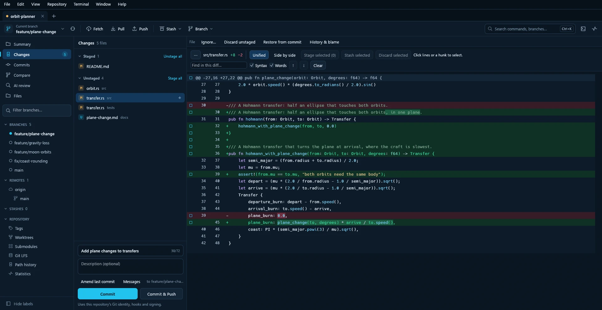

# Getting started

[Wiki home](Home.md) · [Next: everyday workflows](Everyday-workflows.md)

**Goal:** open a project and make one local commit. You do not need a hosting
account, SSH key or MCP server for this walkthrough.

## Before opening Rocket

Download a portable package from [Rocket Releases](https://github.com/JasXTD/Rocket/releases/tag/v0.92.4),
verify its checksum, and extract it into a new folder. Windows packages include
Git; Linux packages need glibc 2.43+ and installed Git. The Apple Silicon and Intel macOS
15+ preview needs installed Git and is not Developer-ID-signed or notarized.
Follow [Build and run](../../README.md#build-and-run) to build from source instead.
**Automatic** uses bundled Git when present, otherwise it searches
installed Git. **Edit → Preferences → Git** also lets you choose an installed or
custom copy, or explicitly require **Bundled Git**. Choices apply after restarting
Rocket. See [Platforms](../../README.md#platforms) for supported versions
and optional tools.

Keep the complete app folder when moving a bundled build. **Verify files** checks
its Git runtime with progress and Stop; a failed or stopped check keeps the saved
choice. It does not install system Git or change PATH, credentials or SSH settings.

## Interface language

Open **Edit → Preferences → General → Languages**.
Choose a language by its own name. Changes apply immediately and are saved for the
next launch. **Preview** means the translation is incomplete; untranslated text
stays English. The dropdown initially shows the detected Windows/system language
when supported, otherwise English. Select any listed language to override it.
Repository files and commit messages are never translated. Rocket 0.92.4 makes
the selector available without a developer launch flag. General, Git, Terminal
and AI draft settings are localized; some advanced screens still use English.

## Open, clone or create?

| What you already have | Choose | What Rocket does |
| --- | --- | --- |
| A folder that is already a Git repository | **File → Open Repository** | Opens the existing local repository |
| A repository URL and no local copy | **File → Clone Repository** | Downloads a copy into a new folder |
| An ordinary project folder with no Git history | **File → New Repository** | Initializes local Git metadata; keeps the existing files |

**Open** needs a real folder path, such as the one copied from File Explorer's
address bar. **Clone** needs a source URL or local repository path and a new
destination. Rocket refuses a clone destination that already exists, even if
it is empty. It does not overwrite an existing folder to make a clone work.

For a private clone, follow [Remotes and accounts](Remotes-and-accounts.md).

## Make your first local commit

**Help → Setup Guide** opens an interactive
walkthrough for these steps. Each button opens the existing dialog; it never
stages or publishes files automatically. **Summary** in the sidebar shows what
needs attention using the same refreshed state as Changes.

Use a separate practice folder if you are learning.

  <picture>
    <source media="(prefers-color-scheme: light)" srcset="../media/hero-light.webp">
    
  </picture>

1. In File Explorer, choose or create a parent folder for your projects. In
   Rocket, open **File → New Repository**, choose a new folder under that parent
   and name the initial branch `main`. Review what will be created, then confirm.
   The parent must exist. If your project is already a repository, open it instead.
2. Open **Repository → Settings → Repository Settings**. Set the author name and commit email
   you want recorded on this repository's commits, then save the identity settings.
   These are commit metadata, not a GitHub login. Local overrides leave your global
   identity unchanged; linked worktrees share the repository settings.
3. In your editor, create or edit `README.md` inside the practice repository.
   Save a short line such as `My first Rocket project`.
4. Return to Rocket and open **Changes**. The file should appear under **Unstaged**.
   Select it and inspect the diff. Rocket normally refreshes after external edits;
   use the command palette to find **Refresh** if the view has not caught up.
5. Drag that file into **Staged**. Use **Stage all** only when you intend to include
   every listed change. Staging is local and does not upload anything.
6. Enter a short commit message, such as `Add project overview`. Review the
   **Staged** list and its diff, then click **Commit**.
7. Open **Commits** and find the new message at the current branch tip. Return to
   **Changes**: the staged entry should be gone. Other edits you did not stage may
   still be listed; that is expected.

You now have a local checkpoint. To send it to a server, continue with
[your first push](Remotes-and-accounts.md#push-a-local-commit). Closing Rocket
does not remove this commit or your working files.

## Why does the same file appear in both groups?

Staging captures a version of a file. If you edit and save it again, the staged
version and the newer working version differ. Review both diffs; stage the new
edits too if they belong in this commit. **Unstage** keeps your working files and
only changes the next commit's selection.

## If Commit is unavailable or fails

- Check that at least one change is staged and that the message is not empty.
- Read the current operation banner: unresolved conflicts or a paused rebase
  need their own recovery action.
- Check the author identity if Git says it does not know who you are.
- Open **Activity** for the result. Hooks, signing or secret protection may refuse
  a commit; follow the displayed reason before retrying.

See [Recovery and troubleshooting](Recovery-and-troubleshooting.md) for the
next step for each type of failure.
