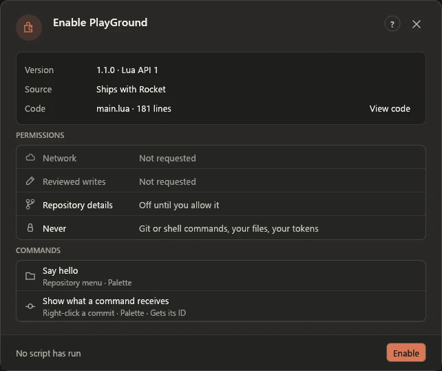

# Extensions

Rocket's extensions are small Lua packages that run in a sandbox and draw native panels.
Jira and PlayGround ship with Rocket, and you can install others from a file. Everything starts in
**Edit → Preferences → Extensions**.

An extension can also add commands: they appear in the command palette, in **Repository →
Extensions**, and on the right-click menus of commits and branches. A command opens the
extension's page and runs there, and any write still stops at the request review. Commit and
branch commands need **Share branch, commit IDs and change counts** on the connection.

## Install and enable

The list shows every extension. **Jira** is there from the first run, switched off. Its
**Enable** switch opens a review of where it came from, its code and its permissions, and the
first Enable copies it into the extensions folder. **Install from file** takes a package's
`integration.json`, with `main.lua` in the same folder, and copies both after the same
review. Rocket can't confirm who made a file, so only install what you trust. Neither step
runs a script: scripts run only from **Refresh panel**, a control in the panel or a command you
choose.

  <picture>
    <source media="(prefers-color-scheme: light)" srcset="../media/review-light.webp">
    
  </picture>

Network reaches only the server you set in a connection. **Reviewed writes** and
**Repository details** stay off until you allow them for a connection. An extension can't run
Git or shell commands, read your files or see your tokens.

Each enabled extension gets its own entry in the sidebar, the icon rail, **View → Go to** and
Preferences, and its own page. An amber dot means it needs a review, or a check of a write
that may have reached the service.

## Update and remove

A newer bundled Jira offers **Update to** its version. **Update from file** in an extension's
details takes a newer `integration.json` with the same ID. An update leaves the extension on or
off as it was. Editing the files in the extensions folder shows **Files changed** after **Reload folders**, with **Review**. Each of
these asks for approval again, marks new permissions, counts changed lines against the approved
copy and shows them with **View changes**. The extension can't run until you approve.

**Remove** takes the extension's files, connections, tokens and drafts, and changes nothing on
the service. Bundled Jira stays in the list, off. It waits while a request may have reached
the service.

## PlayGround and the Lua playground

**PlayGround** is an extension that shows every control a package can use, beside the Lua that
draws it. It ships with Rocket, off. Enable it from the list.

**Developer tools → Open Lua playground** at the foot of the list, or **Lua playground** in the
command palette, opens a scratch editor. Write Lua, select **Run preview**, then use
the rendered native controls. Compact windows have separate **Code** and **Preview**
tabs. This scratch workspace is offline and needs no account.

**Save code** stores your source in a separate Windows-user-protected file. Normal
closing also saves dirty source; a failed save keeps Rocket open. A crash can lose
edits since the last save. Restart restores code without executing it. If another
window or tool changes the saved file, Rocket refuses to overwrite it; **Reload
saved code** asks before discarding your in-memory changes.

**Cancel** stops the worker. Syntax errors, runtime failures and cancellation retain
the last successful preview and its callback state. Editing code disables that
preview's actions until the next successful Run. A fresh Run starts with empty
`ctx.values` and `ctx.state`; preview button callbacks retain them. `ctx.settings`
is empty in the scratch workspace. HTTP calls are shown as request descriptions
and are never sent. No repository metadata, account tokens, OS or filesystem APIs
are available. Source is limited to 64 KiB, with the same memory, instruction and
process timeout limits as installed integrations.

To install the result, put it in a package with a reviewed manifest as described
below. The old component-demo package remains compatible if already installed;
Rocket never removes or rewrites it automatically.

The extensions folder is shown under Developer tools. Each package is a subfolder
containing `integration.json` and `main.lua`. Rocket does not search repositories
for scripts. A package copied there by hand starts off and goes through the same review.
Edit your packages only while they are idle.

Folders that can't load show as rows with their reason; healthy extensions stay available.
If two folders use the same ID, both stay off until you remove one from the list.
Folder-level access errors and the overall package limit stop a reload.

## Connections and saved drafts

A connection is a setting inside its extension. Use **New connection** in the extension's
details to add another account or server. It starts empty. Give it a distinct name,
configure it and choose **Save**. The Connection selector appears in the details and, with two
or more, on the page; each of up to 16 connections has its own access switches, credentials,
drafts and recovery status. One review covers them all. Existing settings appear under
**Default**. Changing the name does not discard a draft.

Forms, script state and the last displayed panel save automatically in protected
local storage. Switching or restarting restores that connection's cached view
without running the script or contacting the service. Use **Refresh panel** to
read fresh data. A brief typing debounce means a crash can lose the latest unsaved
edits; normal closing waits for saves and stays open on failure.

If a script or connection identity changes, Rocket preserves the old draft and
blocks reuse. Restore the original files/settings, or use **Clear saved draft**
after confirming that you no longer need it. Re-entering the same session-only
token keeps its draft binding; replacing the credential does not.

**Remove connection** asks before removing that connection's local credential and
draft. Other connections and remote data are unchanged. An uncertain remote write
must be inspected and acknowledged before its connection can be removed.
Externally edited or damaged storage is never silently overwritten; keep the
window open and resolve the file conflict before **Retry saving draft**.

## Connect a service

Enable **Jira**, then set your Jira Cloud HTTPS server, authentication and project key on its
connection. Jira account API tokens
use **Identifier + token**; enter the account identifier locally. A classic API token uses your
site, such as `https://yoursite.atlassian.net`, and leaves **Cloud ID for scoped tokens** empty.
A token created with scopes only works through Atlassian's gateway: set the server to
`https://api.atlassian.com` and the Cloud ID to your site's ID, which
`https://yoursite.atlassian.net/_edge/tenant_info` shows while you're signed in. Give it the
Jira scopes `read:jira-work` and `write:jira-work`; scopes do not replace the account's project
and issue permissions. See Atlassian's
[API-token authentication guide](https://support.atlassian.com/atlassian-account/docs/manage-api-tokens-for-your-atlassian-account/).
Jira shows your issues beside
the one you choose. One search box takes an issue key, words or JQL, and **My issues**, **Project**,
**This week** and **This branch** switch the list. An issue shows its description and comments,
with **Move to**, **Edit** and **Add a comment**. These use Jira Cloud's
[search API](https://developer.atlassian.com/cloud/jira/platform/rest/v3/api-group-issue-search/)
and [issue/edit/transition API](https://developer.atlassian.com/cloud/jira/platform/rest/v3/api-group-issues/).
The bundled API contract was reviewed against Atlassian's documentation on 2026-11-10.
Isolated tests use synthetic responses, not a real Jira account. Tenant permissions,
token scopes, custom field configurations and workflow validators still require real-account
acceptance. Search can lag recent writes; inspect the issue itself when checking an uncertain
result. An empty search is not proof that a write failed.

**Edit** reads the project's edit metadata. Existing rich descriptions stay unchanged unless
**Replace the description** is selected; an empty replacement clears
the description. Edits and moves require an update marker. Rocket rereads it
before review and send, stopping if the service changed. **Reload** in the edit form reads the new
details and keeps your edit fields, so review them before overwriting newer values.
This check is not atomic with Jira's write and does not detect every workflow or permission
change. Jira can still reject a request after review.

**Create issue** lists up to 32 non-subtask issue types and warns when the list is incomplete.
It checks required fields when you review it, following Jira's returned pagination even when
the server returns fewer fields than requested. It reads at most four metadata pages of up to
50 entries each and blocks creation if it cannot finish the check. Required Description must
be filled; other required fields without defaults are named when the form cannot supply them.
Moves that need extra fields are left out. Use Jira or
extend the script for those fields and screens. Search displays 25 results per page,
up to 20 pages; refine the query beyond that limit. Description previews and
move lists are bounded. A Jira folder from an earlier **Add Jira example** counts as the
bundled Jira. It is never overwritten without the update review; after an update, a draft from
the old version stays saved but blocked until you clear it.

## Developer tools and repository context

**Developer tools → Validate Lua** checks current syntax without running source,
the callback, Git or HTTP. Errors show a source line where available. The local
diagnostic list shows action codes and durations for this connection, omitting
private payloads. **Clear diagnostics** clears that view, not the stored logs.
Reload folders and reapprove code changes separately from validation.

The repository sample, under **Developer tools** in the list, demonstrates optional read-only
Git context offline. A package must request it and you must enable **Share branch, commit
IDs and change counts** for its connection. It shares branch/HEAD/selected commit
IDs and staged/unstaged/untracked/conflicted counts only. Paths, remotes, author
identities and file contents are not exposed. Data is read when an action starts,
not continuously. Refresh to see external changes. A network integration can send
shared metadata to its configured service; grant this permission deliberately.

Tokens stay in the native host and are not included in Lua's context. Remembering
a token is optional; saved tokens use a separate Windows DPAPI-protected file.
Existing Git credentials, hosting accounts and SSH configuration are untouched.
Only enable scripts you trust: enabled scripts can read data from the configured
origin, and a service can return sensitive content in its responses.

On Windows, Rocket checks the worker against its embedded hash and runs it inside
an OS sandbox. The worker cannot directly open private user files, connect to the
network or start another process. Approved service requests still use the native
broker. Unsigned builds are supported; rebuild the complete bundle with
`tools/Build-Local.ps1` when changing the worker. A missing or mismatched worker
blocks execution and preserves the previous panel.

Writes need both a package permission and your **Allow writes** switch on the connection. An action shows the exact method, origin, path and JSON
body. **Back** sends nothing; **Send reviewed request** sends it once. Credentials
are omitted from the review and diagnostics.

**Cancel** immediately shows stopping while Rocket terminates its worker/helper.
A sent write may still complete on the service. If the outcome is uncertain,
inspect the service, refresh the panel, then explicitly acknowledge the result.
This guard survives closing or crashing Rocket. Restart never replays a request.

## Build your own panel

See [Lua API 1](../../INTEGRATIONS.md) and the
[playground source](../../crates/rocket-integrations/examples/playground/main.lua).
Lua can arrange its own native panels, cards, inputs, choices, buttons and tables.
It cannot replace Rocket's trusted review/permission UI or inject arbitrary HTML,
JavaScript, native widgets, shell commands or Git operations.

Team dashboards can connect to your own service through the same API. This feature
does not provide a collaboration server, shared authentication, background
synchronization or live multi-user editing.
