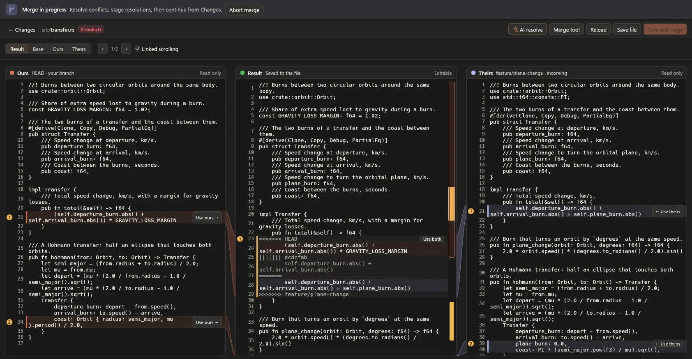

# Recovery and troubleshooting

[Wiki home](Home.md) · [Everyday workflows](Everyday-workflows.md) · [Remotes](Remotes-and-accounts.md)

Start with **Activity** and the operation banner. Read which step finished,
which failed, and whether the result is confirmed. A failure does not always
mean nothing changed.

## What to do next

| What you see | Next step |
| --- | --- |
| Git executable not found | Select your installed Git in **Edit → Preferences → Git** |
| Bundled Git missing or changed | Restore the complete matching app bundle, or select another trusted Git installation in Preferences and restart. A damaged included runtime does not silently fall back to PATH |
| Folder not found / not a repository | Open the actual project folder; use New Repository only if it has no Git metadata |
| Clone destination exists | Choose a new destination name; open the existing clone if that is the one you want |
| Commit unavailable | Stage changes, enter a message and inspect any active conflict/recovery banner |
| Commit identity missing | Save a name/email under **Repository → Settings → Repository Settings** |
| HTTPS authentication rejected | Check Git's credential helper and repository permission; a hosting API login is separate |
| SSH key or agent unavailable | Unlock/load the correct local key and check your SSH profile; keep existing keys intact |
| Host-key verification failure | Verify the server fingerprint through a trusted source before changing known-host entries |
| Push rejected because the remote changed | Fetch, inspect the new history and choose an integration strategy |
| Protected branch rejection | Use the repository's pull-request workflow; do not disable protection to make a push pass |
| Review is stale / external files changed | Refresh and create a new preview of the current state |
| Repository write already running | Let the owning Rocket window/CLI operation finish or stop it and wait for reconciliation |
| Secret protection refusal | Remove the actual credential from the affected commit/history; revoke it if it was exposed |

Do not delete Git lock files or recovery data just to dismiss an error. Another
Git process may still own them. Inspect the active process and reported operation
before changing repository metadata.

## Undo the last local commit

In the current unreleased build, an ordinary **Commit** offers **Edit → Undo last
commit** and **Summary → Undo last commit**. Review the commit and choose
**Undo commit · keep changes**. Its changes become staged again; newer working,
untracked and ignored files stay intact. A first commit can be undone too.

The offer belongs to this session and ends after another Rocket write or closing
the tab/app. It is not a general Undo/Redo history: amend, merge, Commit & Push and
earlier commits use their existing recovery tools. **Ctrl+Z** still edits text.

Undo refuses later staging, a moved branch/tip, an active Git operation, an
existing Git lock and external edits after review. Reviews expire after two
minutes. It also refuses commits contained in known remote-tracking branches;
it does not contact a server, so use Revert for anything you shared elsewhere.

Before moving the branch, Rocket retains the commit at the recovery reference
shown in the review and Activity. Keep that reference if you may need the commit
again. Stop checks what completed: a branch move that already finished stays
finished. Read Activity before retrying an unconfirmed result.

## Resolve a conflict

  <picture>
    <source media="(prefers-color-scheme: light)" srcset="../media/conflict-light.webp">
    
  </picture>

1. Open **Changes** and read the banner naming the interrupted operation.
2. Select a conflicted file and open its conflict editor. Read the side labels
   and use conflict navigation to visit each unresolved section.
3. Choose the intended contents or edit the result. With text conflicts, inspect
   the combined result rather than choosing a whole side by habit.
4. Use **Save and stage** when the result is ready, reviewing the confirmation.
   Rocket rechecks the working file and keeps recovery copies before replacement.
5. Resolve and stage the other conflicted files. Use the operation's **Continue**
   action when all resolutions are ready.
6. Read the final result and inspect the resulting history and working changes.

Saving a resolved file does not itself finish a rebase or cherry-pick. Continue
does that next step. For a binary or delete/modify conflict, choose a supported
whole version or use an external workflow; line editing is not applicable.

During rebase, **ours** means what your commit goes on top of, with your earlier commits already there;
**theirs** is the commit being moved. Do not interpret those names as simply
“my original branch” and “the other person's branch.”

### Review an AI proposal

For a supported text conflict, **AI resolve** asks for a proposal, from Changes or the
conflict editor. Choose who answers: Claude Code or Codex on this computer, or an AI app
connected to Rocket's MCP server. Check **Goes to** and **Sends**, then send, or choose
**Share with agent** and copy its instructions into your AI app. Rocket does not require
an AI API key; the provider you choose handles the shared code and any usage charges.

Review each proposal and reason before **Apply to editor draft**. Confidence is the
AI's estimate, not validation. Each applied conflict keeps its own Undo in the editor.
Saving and staging remain separate actions with recovery copies and checks for
external file/Git-context changes.
**Cancel** revokes access to the request; it also expires after 15 minutes. Context
is limited to 128 KiB, proposals to 32 KiB and 32 complete conflict sections.
Oversized context is refused rather than truncated. Test the resulting code before
continuing the Git operation. No proposal automatically commits or pushes.

### Continue, Skip or Abort?

| Action | Meaning |
| --- | --- |
| **Continue** | Resume after you have resolved and staged the required changes |
| **Skip**, where available | Omit the stopped change/step; this can discard work shown in its review |
| **Abort** | Stop the sequence and attempt the operation's documented restoration |

Read the preview before Skip or Abort. Restoration depends on the operation;
tracked conflict-resolution edits can be discarded. Neither action is a general
undo for unrelated changes or a remote update. See the detailed
[rebase recovery rules](../../crates/rocket-ui/src/guide.md#continue-skip-and-abort).

## An external editor changed the file

Rocket invalidates a preview when the file or relevant repository state no
longer matches what you reviewed. Keep the editor's changes, refresh the view
and make a fresh review. If you also have an unsaved result you need, copy it to
a separate safe file before reopening the operation. Do not overwrite the newer
working file just to reuse an old preview.

## Cancel or Stop was pressed

**Stopping** means cancellation has been requested. Rocket then checks what
already completed. A remote operation may show a separate result-checking phase.
Wait for that phase and inspect the result before retrying.

- A commit may already exist locally. Look in **Commits** before creating another.
- A push may already have updated the server. Fetch or inspect the destination
  branch if the result is unknown; do not assume it was rolled back.
- A stash may already exist or have been applied partly. Inspect both the stash
  list and **Changes** before applying it again.
- Closing an operation dialog or stopping a process is not a rollback command.

## Recover a commit or a file

- **Lost branch tip or rewritten commit:** use **Repository → History & Recovery → Reflog & Recovery** to inspect
  known previous tips. Recover onto a new branch so you can review before making
  another history change. Lost-commit search can help with unreachable commits.
- **Discarded/restored file:** inspect the operation's recovery information.
  Supported file operations keep backups in the repository's Git directory;
  preserve those copies while deciding what to restore.
- **Stash conflict:** the stash is retained. Inspect the changes already present
  and resolve the conflict before trying any further application.

These are recovery aids, not permanent backups of every edit. Git cannot recover
an arbitrary unsaved editor buffer or guarantee recovery of data it never stored.

## Share a useful diagnostic report

1. Note Rocket's version, the operation, the steps that led to the problem and
   the displayed error code.
2. Open **View → Activity & Diagnostics** and select the relevant operation.
3. Use **Copy summary** for the structured record. Review it before sharing.
4. Include a small reproduction with invented files if possible. Describe the
   expected result and what actually happened.

The session's Activity drawer can show raw Git output on request. That output can
contain private repository information; keep tokens, private keys and private
file contents out of reports. Log rotation and an **Incomplete** entry can mean
the available records do not establish the final outcome.

## Stop a command in the terminal

Click the terminal screen and press **Ctrl+C**, or use **Interrupt**. After the
command exits, the same shell prompt should be usable. The Terminal menu
acts on that terminal session; it is separate from Stop on a Rocket Git operation.
**End session** closes the shell; **Terminal → New Terminal** starts another one.
